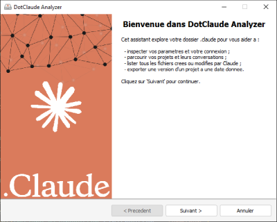
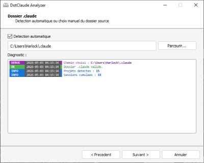
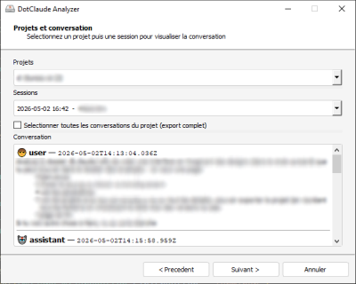
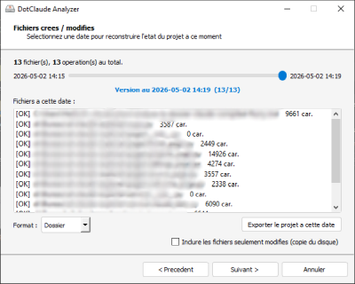

<p align="center">
  <a href="https://github.com/Game-K-Hack/dotclaude-analyzer/releases/latest"></a>
</p>

**:fr: Français** | 
[:uk: English](../README.md) | 
[:kr: 한국어](./README.ko.md) | 
[:jp: 日本語](./README.ja.md) | 
[:cn: 中文](./README.zh.md) | 
[:it: Italiano](./README.it.md) | 
[:es: Español](./README.es.md) | 
[:ru: Русский](./README.ru.md) | 
[:de: Deutsch](./README.de.md)

### DotClaude Analyzer

**DotClaude Analyzer** est une application graphique qui explore votre dossier `.claude` afin de vous aider à mieux comprendre et exploiter votre activité avec Claude Code.

L'assistant vous permet de :

- inspecter vos paramètres et votre connexion ;
- parcourir vos projets et relire l'intégralité de leurs conversations ;
- lister tous les fichiers créés ou modifiés par Claude ;
- exporter une version complète d'un projet à une date donnée.

---

### Installation

```
git clone https://github.com/Game-K-Hack/dotclaude-analyzer.git
pip install -r requirements.txt
```

#### Lancement de l'interface graphique

```
python main.py
```

#### Build en EXE

```
pyinstaller --noconfirm build.spec
```

---

### Démonstration



Sélectionner un dossier `.claude` qui se trouve dans le dossier `User`



Sélectionner un projet à récupérer (vous pouvez relire ces conversations)



Sélectionner la version des fichiers à exporter


